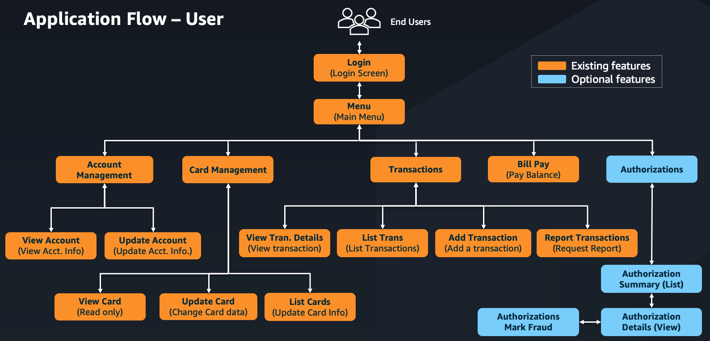
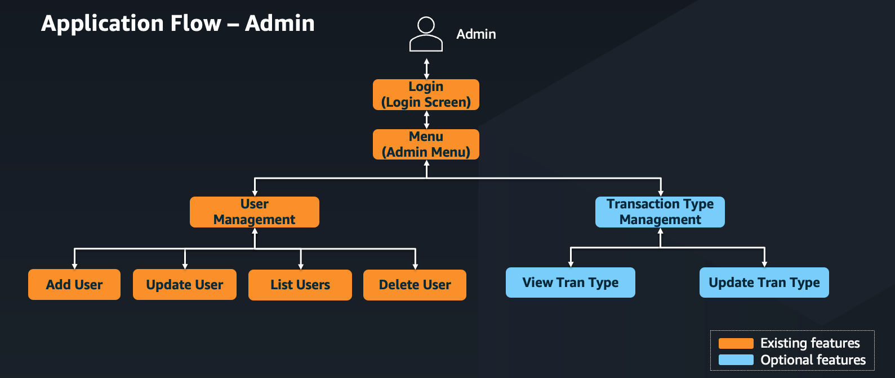
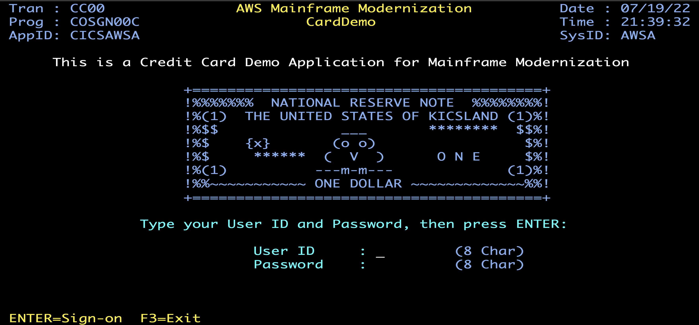
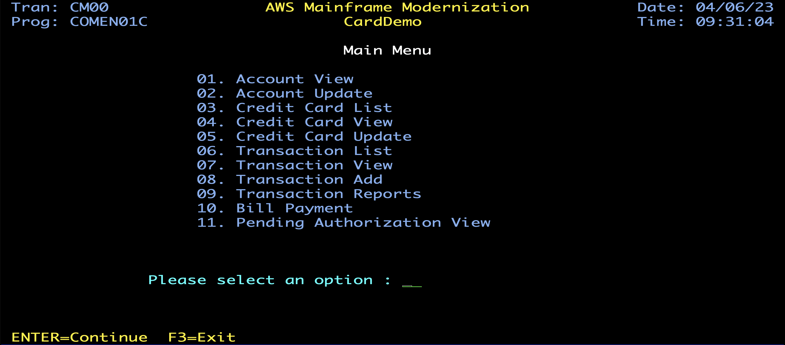
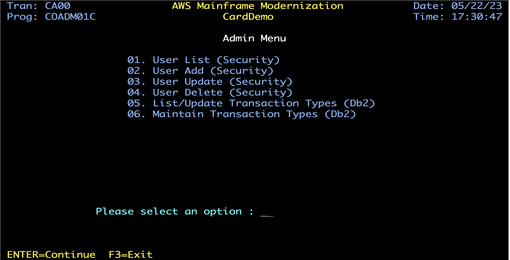

# CardDemo Lite - Mainframe Credit Card Management Application


## Executive Summary
CardDemo is a comprehensive mainframe application that simulates a credit card management system. Designed specifically to showcase AWS and partner technologies for mainframe migration and modernization scenarios, it provides a realistic environment for testing various modernization approaches including discovery, migration, performance testing, service enablement, and more.

## Table of Contents
- [Description](#description)
- [Technologies](#technologies)
- [Lite Edition](#lite-edition)
- [Installation](#installation)
- [Running Batch Jobs](#running-batch-jobs)
- [Application Details](#application-details)
  - [User Functions](#user-functions)
  - [Admin Functions](#admin-functions)
  - [Application Inventory](#application-inventory)
  - [Application Screens](#application-screens)
- [Technical Highlights](#technical-highlights)
- [Support](#support)
- [Roadmap](#roadmap)
- [Contributing](#contributing)
- [License](#license)
- [Project Status](#project-status)

## Description
CardDemo is a mainframe application designed to test and showcase AWS and partner technology for mainframe migration and modernization use-cases. It provides a realistic environment for:

- Application discovery and analysis
- Migration assessment and planning
- Modernization strategy development
- Performance testing
- System augmentation
- Service enablement and extraction
- Test creation and automation

The application intentionally incorporates various coding styles and patterns to exercise analysis, transformation, and migration tooling across different mainframe programming paradigms.

## Technologies

### Core Technologies
- **COBOL**: Primary programming language
- **CICS**: Transaction processing
- **VSAM (KSDS with AIX)**: Data storage
- **JCL**: Batch processing
- **RACF**: Security
- **ASSEMBLER**: System-level programming
  - COBDATFT: Date format conversion utility

### Additional Technical Coverage
- **JCL Utilities**: IDCAMS, IEBGENER, IEFBR14, SORT, SDSF, Internal Reader (via TDQ)
- **LE Services**: CEEDAYS date validation
- **Advanced Data Formats**: COMP, COMP-3, Zoned Decimal, Signed, Unsigned
- **Additional Dataset Types**: VSAM (ESDS/RRDS), GDG, PDS
- **Record Formats**: VB, FBA, and others
- **Complex Copybook Structures**: REDEFINES, OCCURS, OCCURS DEPENDING ON

## Lite Edition

This repository is the **Lite** edition of CardDemo. It keeps the core business functions and the full range of technical coverage (COBOL / CICS / BMS / VSAM / JCL / ASM / LE) of the original application, but removes duplicated programs, look-alike screens, helper utilities and the optional modules. See [docs/spec-carddemo-lite.md](./docs/spec-carddemo-lite.md) for the full specification and the rationale for each removal.

- 12 online programs, 7 batch/utility COBOL programs, 1 assembler routine, 12 BMS mapsets, 25 JCLs.
- Only the CICS + VSAM technology stack is kept. The IMS, Db2 and MQ optional modules, the scheduler definitions and the deployment samples have been removed.
- Account view and card view are part of the corresponding update screens (`COACTUPC`, `COCRDUPC`).
- The transaction list is available as the transaction report (`CORPT00C` -> `TRANREPT`). Users are created by the `DUSRSECJ` job.

## Installation

### Prerequisites
- Mainframe environment with CICS, VSAM, and JCL support
- File transfer capability between local environment and mainframe

### Installation Steps

1. **Prepare Your Environment**
   - Clone this repository to your local development environment
   - Ensure you have appropriate access to your mainframe environment

2. **Create Mainframe Datasets**
   - Define a High Level Qualifier (HLQ) for your datasets
   - Create the following datasets with the specified formats:

     | HLQ    | Name          | Format | Length |
     | :----- | :------------ | :----- | -----: |
     | AWS.M2 | CARDDEMO.JCL  | FB     |     80 |
     | AWS.M2 | CARDDEMO.PROC | FB     |     80 |
     | AWS.M2 | CARDDEMO.CBL  | FB     |     80 |
     | AWS.M2 | CARDDEMO.CPY  | FB     |     80 |
     | AWS.M2 | CARDDEMO.BMS  | FB     |     80 |
     | AWS.M2 | CARDDEMO.ASM  | FB     |     80 |
     | AWS.M2 | CARDDEMO.MACLIB| FB    |     80 |

3. **Upload Source Code**
   - Upload the application source folders from the repository to your mainframe
   - Use $INDFILE or your preferred file transfer tool
   - Ensure proper transfer modes (binary/text) as appropriate

4. **Upload Sample Data**
   - Transfer the sample data from the `main/-/data/EBCDIC/` folder to the mainframe
   - Use binary transfer mode to preserve data integrity
   - Create the following datasets:

     | Dataset name                      | Description                                  | Copybook     | Format | Length |
     | :---------------------------------| :------------------------------------------- | :----------- | :----- | -----: |
     | AWS.M2.CARDDEMO.USRSEC.PS         | User Security file                           | CSUSR01Y     | FB     |     80 |
     | AWS.M2.CARDDEMO.ACCTDATA.PS       | Account Data                                 | CVACT01Y     | FB     |    300 |
     | AWS.M2.CARDDEMO.CARDDATA.PS       | Card Data                                    | CVACT02Y     | FB     |    150 |
     | AWS.M2.CARDDEMO.CUSTDATA.PS       | Customer Data                                | CVCUS01Y     | FB     |    500 |
     | AWS.M2.CARDDEMO.CARDXREF.PS       | Customer Account Card Cross reference        | CVACT03Y     | FB     |     50 |
     | AWS.M2.CARDDEMO.DALYTRAN.PS.INIT  | Transaction database initialization record   | CVTRA06Y     | FB     |    350 |
     | AWS.M2.CARDDEMO.DALYTRAN.PS       | Transaction data for posting                 | CVTRA06Y     | FB     |    350 |
     | AWS.M2.CARDDEMO.TRANSACT.VSAM.KSDS| Online transaction data                      | CVTRA05Y     | FB     |    350 |
     | AWS.M2.CARDDEMO.DISCGRP.PS        | Disclosure Groups                            | CVTRA02Y     | FB     |     50 |
     | AWS.M2.CARDDEMO.TRANCATG.PS       | Transaction Category Types                   | CVTRA04Y     | FB     |     60 |
     | AWS.M2.CARDDEMO.TRANTYPE.PS       | Transaction Types                            | CVTRA03Y     | FB     |     60 |
     | AWS.M2.CARDDEMO.TCATBALF.PS       | Transaction Category Balance                 | CVTRA01Y     | FB     |     50 |

5. **Initialize the Environment**
   - Execute the following JCLs in sequence:

     | Jobname  | Purpose                                           |
     | :------- | :------------------------------------------------ |
     | DUSRSECJ | Sets up user security VSAM file                   |
     | CLOSEFIL | Closes files opened by CICS                       |
     | ACCTFILE | Loads Account database using sample data          |
     | CARDFILE | Loads Card database with credit card sample data  |
     | CUSTFILE | Creates customer database                         |
     | XREFFILE | Loads Customer Card account cross reference       |
     | TRANFILE | Copies initial Transaction file to VSAM           |
     | DISCGRP  | Copies initial Disclosure Group file to VSAM      |
     | TCATBALF | Copies initial TCATBALF file to VSAM              |
     | TRANCATG | Copies initial transaction category file to VSAM  |
     | TRANTYPE | Copies initial transaction type file to VSAM      |
     | OPENFIL  | Makes files available to CICS                     |
     | DEFGDGB  | Defines GDG Base                                  |
     | DALYREJS | Defines GDG for rejected transactions             |
     | REPTFILE | Defines GDG for transaction reports               |
     | ESDSRRDS | Creates ESDS and RRDS VSAM files                  |

6. **Compile the Programs**
   - Use your standard mainframe compilation procedures
   - The `samples` folder of the original CardDemo is not part of the Lite edition; use your site's compile JCL (see `scripts/compile_batch.jcl.template` as a starting point)

7. **Configure CICS Resources**
   - Option 1 (Preferred): Use the DFHCSDUP JCL with the CSD file in the CSD folder
   - Option 2: Use CEDA transaction to manually define resources:

     ```
     DEFINE LIBRARY(COM2DOLL) GROUP(CARDDEMO) DSNAME01(&HLQ..LOADLIB)
     DEF PROGRAM(COCRDLIC) GROUP(CARDDEMO)
     DEF MAPSET(COCRDLI) GROUP(CARDDEMO)
     DEFINE PROGRAM(COSGN00C) GROUP(CARDDEMO) DA(ANY) TRANSID(CC00) DESCRIPTION(LOGIN)
     DEFINE TRANSACTION(CC00) GROUP(CARDDEMO) PROGRAM(COSGN00C) TASKDATAL(ANY)
     ```

8. **Install and Load Resources**
   - Install the resources in your CICS region:

     ```
     CEDA INSTALL TRANS(CCLI) GROUP(CARDDEMO)
     CEDA INSTALL FILE(CARDDAT) GROUP(CARDDEMO)
     CECI LOAD PROG(COCRDUP)
     CECI LOAD PROG(COCRDUPC)
     ```

   - Execute NEWCOPY for mapsets and programs:

     ```
     CEMT SET PROG(COCRDUP) NEWCOPY
     CEMT SET PROG(COCRDUPC) NEWCOPY
     ```

### Accessing the Application
- **Online Functions**: Start the CardDemo application using the CC00 transaction
  - Admin access: Use userid ADMIN001 with password PASSWORD
  - User access: Use userid USER0001 with password PASSWORD
- **Batch Functions**: See the "Running Batch Jobs" section below

## Running Batch Jobs

Execute the following JCLs in sequence to run the full batch process:

| Jobname  | Purpose                                             |
| :------- | :-------------------------------------------------- |
| CLOSEFIL | Closes files opened by CICS                         |
| ACCTFILE | Loads Account database using sample data            |
| CARDFILE | Loads Card database with credit card sample data    |
| XREFFILE | Loads Customer Card account cross reference to VSAM |
| CUSTFILE | Creates customer database                           |
| TRANFILE | Creates Transaction database                        |
| TRANCATG | Copies latest transaction category file to VSAM     |
| TRANTYPE | Copies latest transaction type file to VSAM         |
| DISCGRP  | Copies initial disclosure Group file to VSAM        |
| TCATBALF | Copies initial TCATBALF file to VSAM                |
| DUSRSECJ | Sets up user security VSAM file                     |
| POSTTRAN | Core transaction processing job                     |
| INTCALC  | Run interest calculations                           |
| TRANBKP  | Backup Transaction database                         |
| COMBTRAN | Combine system transactions with daily ones         |
| TRANIDX  | Define alternate index on transaction file          |
| CREASTMT | Produce transaction statement                       |
| OPENFIL  | Makes files available to CICS                       |

## Application Details

CardDemo is a comprehensive credit card management application built primarily using COBOL. It provides functionality for managing accounts, credit cards, transactions, and bill payments.

### User Types

The application supports two user roles:
- **Regular Users**: Can perform standard card management functions
- **Admin Users**: Can perform administrative functions like user management

### User Functions



The regular user can perform the following functions:
- View and update account information
- List, view and update credit cards
- View and add transactions
- Request transaction reports
- Make bill payments

### Admin Functions



Admin users can perform the following functions:
- User management (update, delete)

### Application Inventory

#### Online Components

| Transaction | BMS Map | Program  | Function                        | Notes                                              |
|:------------|:--------|:---------|:--------------------------------|:---------------------------------------------------|
| CC00        | COSGN00 | COSGN00C | Signon Screen                   |                                                    |
| CM00        | COMEN01 | COMEN01C | Main Menu                       | 7 options                                          |
| CAUP        | COACTUP | COACTUPC | Account View/Update             | Account and customer, optimistic check, SYNCPOINT  |
| CCLI        | COCRDLI | COCRDLIC | Credit Card List                | Filter, 2-way paging, select S/U                   |
| CCUP        | COCRDUP | COCRDUPC | Credit Card View/Update         |                                                    |
| CT01        | COTRN01 | COTRN01C | Transaction View                | Enter Transaction ID                               |
| CT02        | COTRN02 | COTRN02C | Transaction Add                 | Calls CSUTLDTC                                     |
| CR00        | CORPT00 | CORPT00C | Transaction Reports             | Submits TRANREPT through TDQ JOBS                  |
| CB00        | COBIL00 | COBIL00C | Bill Payment                    |                                                    |
| CA00        | COADM01 | COADM01C | Admin Menu                      | 2 options                                          |
| CU02        | COUSR02 | COUSR02C | Update User                     | Enter User ID                                      |
| CU03        | COUSR03 | COUSR03C | Delete User                     | Enter User ID                                      |

#### Batch Components

| Job      | Program  | Function                                             |
|:---------|:---------|:-----------------------------------------------------|
| DUSRSECJ | IEBGENER | Initial Load of User security file                   |
| DEFGDGB  | IDCAMS   | Setup GDG Bases                                      |
| DALYREJS | IDCAMS   | Define GDG for rejected transactions                 |
| REPTFILE | IDCAMS   | Define GDG for reports                               |
| ACCTFILE | IDCAMS   | Refresh Account Master                               |
| CARDFILE | IDCAMS   | Refresh Card Master                                  |
| CUSTFILE | IDCAMS   | Refresh Customer Master                              |
| DISCGRP  | IDCAMS   | Load Disclosure Group File                           |
| TRANFILE | IDCAMS   | Load Transaction Master file                         |
| TRANCATG | IDCAMS   | Load Transaction category types                      |
| TRANTYPE | IDCAMS   | Load Transaction type file                           |
| XREFFILE | IDCAMS   | Account, Card and Customer cross reference           |
| CLOSEFIL | IEFBR14  | Close VSAM files in CICS                             |
| TCATBALF | IDCAMS   | Refresh Transaction Category Balance                 |
| TRANBKP  | IDCAMS   | Refresh Transaction Master                           |
| POSTTRAN | CBTRN02C | Transaction processing job                           |
| TRANIDX  | IDCAMS   | Define AIX for transaction file                      |
| OPENFIL  | IEFBR14  | Open files in CICS                                   |
| INTCALC  | CBACT04C | Run interest calculations                            |
| COMBTRAN | SORT     | Combine transaction files                            |
| CREASTMT | CBSTM03A | Produce transaction statement                        |
| TRANREPT | CBTRN03C | Transaction Report - Submitted from CICS             |
| READACCT | CBACT01C | Read Account Master and write 3 output formats       |
| ESDSRRDS | IDCAMS   | Create ESDS and RRDS VSAM files                      |
| CBADMCDJ | DFHCSDUP | Install CardDemo CSD definitions                     |

### Application Screens

#### Signon Screen



#### Main Menu



#### Admin Menu



## Technical Highlights

| Component | Domain Features | Technical Features |
|:----------|:----------------|:-------------------|
| **Base Application** | Customer<br>Account<br>Card<br>Transaction<br>Bill Payment<br>Statement/Report | COBOL<br>CICS<br>JCL (Batch)<br>VSAM (KSDS with AIX) |
| **Additional Coverage** | Interest calculation<br>Statement (text and HTML) | JCL Utilities<br>Complex data formats<br>Various dataset types<br>Advanced copybook structures<br>Assembler and LE calls |

## Support

For questions, issues, or improvement requests, please raise an issue in the repository with detailed information about your concern. The maintainers will respond according to availability.

## Roadmap

The following features are planned for upcoming releases:

1. **Additional Database Syntax Usage Scenarios**
   - DB2 Rewards: Calculate rewards for transactions based on transaction types, categories, and rules
     - Will include stored procedures, functions, and dynamic SQL
   - Hierarchical database: IMS DC implementation

2. **Integration Enhancements**
   - FTP and SFTP integration
   - Web Service connectivity
   - Exposure of transactions for distributed application integration

## Contributing

We welcome contributions and enhancements to this codebase from the mainframe community. To contribute:

1. Fork the repository
2. Create your feature branch
3. Implement your changes with appropriate tests
4. Submit a pull request with a clear description of the changes

Feel free to raise issues, create code, and submit merge requests for enhancements to help build this application as a resource for programmers wanting to understand and modernize their mainframes.

## License

This project is intended to be a community resource and is released under the Apache 2.0 license.

## Project Status

CardDemo Lite is a reduced edition of CardDemo that keeps the core business flow (sign-on, inquiry/update, transaction posting, interest calculation, reporting and statements) and the full range of CICS/VSAM/COBOL/JCL/ASM coverage, in a smaller code base that is easier to read, analyze and modernize. The Db2, IMS DB and MQ optional modules are not part of this edition. If Embedded SQL coverage is needed later, restore `app-transaction-type-db2` from the upstream CardDemo repository; it is small and independent.

Last updated: April 2025

